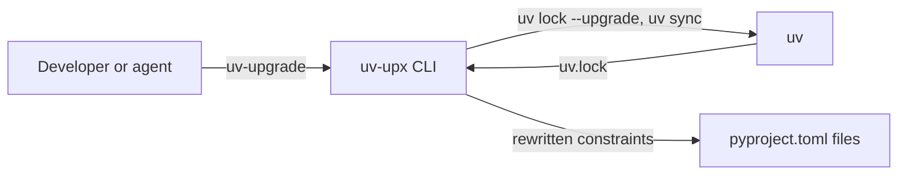

# Architecture of uv-upx

Reviewed against the code on 2026-11-28.

## Context

A developer (or an agent) runs `uv-upgrade` or `uv-upx upgrade run` in a uv project or workspace root. uv-upx runs `uv lock --upgrade` as a subprocess, reads the locked versions from `uv.lock`, rewrites the constraints in every `pyproject.toml` of the workspace, then runs `uv sync` (or only relocks with `--no-sync`). It is published on PyPI. What uv owns and what uv-upx owns: [docs_extra/boundaries.md](docs_extra/boundaries.md).

## Containers

One Python package, `src/uv_upx/`, with two console scripts: `uv-upgrade` (the simple command) and `uv-upx` (subcommands, profiles, interactive mode). `cli/` holds the Typer commands; `services/` holds one module per step: finding the `pyproject.toml` files, reading the lock into a `DependenciesRegistry`, deciding each new constraint (`dependency_up/`), rewriting with tomlkit (`toml/`), running uv (`run_uv_related/`) and rolling back (`updater/`). Tests sit next to the code in `tests/` folders; uv is faked by `tests/fake_uv.py`.

## Invariants

- uv-upx never writes `uv.lock`: it reads it; uv writes it.
- Only `>=` floors move by default; `==`, `<`, `<=`, `~=` and other upper bounds are kept (the `with_pinned` profile also moves `==`).
- A failed `uv lock` or `uv sync` restores `pyproject.toml` and `uv.lock` as they were.
- uv is called only through `services/run_uv_related/`.

## Where to start reading

- `src/uv_upx/services/updater/`: the run from start to rollback.
- `src/uv_upx/services/dependency_up/`: the rule for each constraint, with hypothesis properties.
- `docs_extra/behaviour.md` and `docs_extra/boundaries.md`: every rule with examples, and who owns what.
