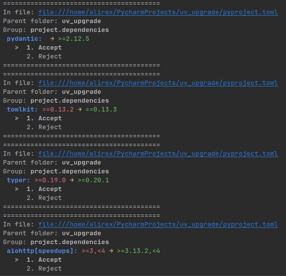

# Behaviour

How `uv-upx` treats each kind of dependency constraint. The [README](../README.md) shows the common cases.

## Uv as a source of truth

Run `uv sync --all-groups --all-extras --all-packages --upgrade`.

Get dependencies versions from `uv.lock`.

Put them in `pyproject.toml` files in related groups.

So, the main responsibility for dependencies resolution is on `uv`.

## Workspace support

It works with workspaces. At least for some basic cases.

Respects:

- both `members` and `exclude` sections.
- glob-based patterns.

## Normalize dependencies names

For example:

- `TOMLKit` -> `tomlkit`
- `Pydantic` -> `pydantic`
- `pyTEST_BenchMark` -> `pytest-benchmark`

## Updates simple dependencies

Updates `>=` dependencies. Like `bla>=2.0.0`.

Because, in this case, we can simply put the new version instead of the old one.

Update the similar part of the constraint in the multi-constraint.

A constraint equal to the locked version by its numbers (`>=1.0` with `1.0.0` locked) is left as written.

## Skip pinned versions and upper bounds

It doesn't touch pinned versions. Like `bla==2.0.0`.

It doesn't touch lower bounds. Like:

- `bla<=2.0.0`
- `bla~=2.0.0`

## Respect simple ranges and some combined constraints

It respects simple dependency ranges. Like `bla>=1.0.0,<2.0.0`.

It moves the lower bound to the new version.

In fact, it handles any part of the constraint with a supported operator.

## Respect extras

It respects extras. Like `bla[dev]>=1.0.0;python_version>="3.14"`.

## Fix undefined constraints with lower bound to the new version

It sets undefined lower bounds to the new version.

For example, before:

```toml
dependencies = [
    "foo>=1.0.0",
    "bla",
]
```

After:

```toml
dependencies = [
    "foo>=1.0.0",
    "bla>=2.0.0",
]
```

To keep such dependencies as they are, run with `--keep-unconstrained`:

```shell
uv-upgrade --keep-unconstrained
```

Then only the dependencies that already have a constraint are updated.

## Skip unhandled constraints

It skips unhandled and complex constraints. Like:

- `bla<1.0.0`

## Style preservation

It preserves comments in the `pyproject.toml` file. Like here:

```toml
dependencies = [
    # Better classes and data validation
    "pydantic>=2.12.5",
    # TOML parser and writer with preserved formatting
    "tomlkit>=0.13.3",
    # CLI app framework
    "typer>=0.20.0",
]
```

## Rollback

If something goes wrong, it rolls back the changes to the `pyproject.toml` and `uv.lock` files.

## Rollback on no-changes

If nothing from pyproject.toml was changed, it rolls back the changes to the `uv.lock` file.

So, only top-level dependencies changes trigger a `uv.lock` update.

## Upgrade `equal`/`pinned` dependencies

Honestly, I think it's insecure to upgrade pinned dependencies automatically.
Because they must be pinned for a reason.

For applications that require strict control of dependencies, maybe better to use `frozen` mode of `uv sync`.

But for someone it can be useful to upgrade pinned dependencies automatically.

And we can do it.

```shell
uv-upgrade --profile with_pinned
```

It handles only `equal` (`==`) and NOT `strictly equal` (`===`) operators.

So, even in this mode, it won't change `bla===2.0.0`.

Under the hood it:

- collect all top-level dependencies information
- changes `==` version constraints to `>=`
- runs the standard upgrade process by `uv`
- upgrade `pyproject.toml` files accordingly with returning `==` constraints back

Note: more `upgrade` profiles can be added later. Or/and custom verbose `features` options.

Note: Can be combined with `--interactive` mode.

## Interactive mode

You can run the tool in interactive mode.

You must `Accept` or `Reject` each proposed change.

```shell
uv-upgrade --interactive
```

Demo example:



## Get special cases

This allows you to see all the top-level dependencies that have some special constraints.
Like:

- ranges (`bla>=1.0.0,<2.0.0`)
- not defined bounds (`bla`)
- equal/pinned dependencies (`bla==2.0.0`)
- unhandled constraints (`bla<1.0.0`)

```shell
uv-upx helpers collect-top-level-dependencies-from-project --only-special-cases
```

## Why?

I needed this for my own projects.

I know these issues:

- [Upgrade dependencies in pyproject.toml (uv upgrade)](https://github.com/astral-sh/uv/issues/6692)
- [What is the intended workflow for updating dependencies with uv?](https://github.com/astral-sh/uv/issues/6794)

But I didn't see enough progress.

So, I implemented this tool for my own usage.

Maybe it will be useful for someone else.

## Why not in Rust?

Because it's a temporary Proof-of-Concept.

Maybe it will be replaced by Rust in the future.

It uses type annotations anyway. For simpler migration.
